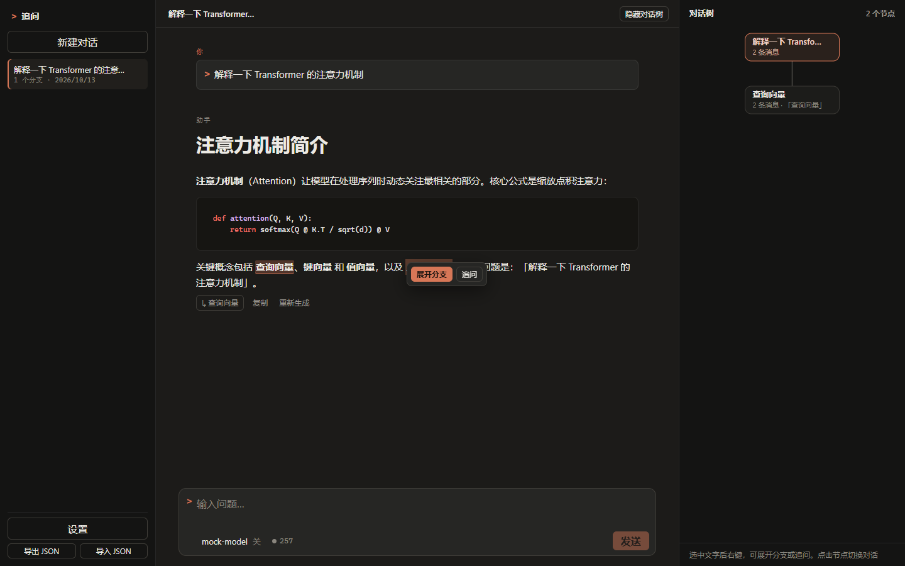

# 追问 KeepAsking

一个支持**划词展开分支**与**实时对话树**的 AI 桌面客户端。
跨平台（Windows / macOS / Linux），自带 API Key（BYOK），数据全部保存在本机。



## ✨ 功能

- **划词**：在消息里选中文字后右键，菜单中有「展开分支」和「追问」。
- **展开分支**：以选中文字为锚点开启子对话，可多层嵌套。上下文是祖先链截至锚点的历史、引用的原文，以及这条分支里之后的消息。原文中的锚点会高亮，点击跳进该分支；分支顶部可「← 返回原文」。
- **追问**：打开可拖动的临时窗口，可写补充说明后再开始。当前对话不切换，对话树也不计入这条追问。原文出现虚线下划线，再点击会打开当时的窗口。
- **对话树**：右侧 SVG 树从上到下展开。当前节点和路径高亮，流式生成中的节点有提示，点击即可切换。
- **输入栏**：模型和思考力度（关 / 低 / 中 / 高）是一枚标签，上下文占用是另一枚。占用明细里可以「压缩上下文」：之后发给模型的内容换成摘要，界面上的原文和已有分支保持原样。
- **阅读长对话**：模型还没返回文字时显示 Thinking。同一节点有多轮用户消息时，右侧出现刻度，悬停看缩略，点击滚到对应位置。
- **设置**：一般（白天 / 黑暗 / 跟随系统，以及数据目录）、字体（中英文字体列表，可搜索）、提供商（BYOK，并可拉取模型列表）。
- **BYOK 多服务商**：OpenAI 兼容接口（OpenAI、DeepSeek、OpenRouter、xAI、Ollama 等）与 Anthropic 接口，均为流式输出。请求由主进程发出，没有浏览器 CORS 限制。
- **安全存储 Key**：API Key 使用 Electron `safeStorage` 加密（macOS 钥匙串 / Windows DPAPI / Linux libsecret 或 KWallet）。渲染进程只知道「是否已保存」，拿不到明文。
- **本地数据**：会话保存在用户数据目录的 `data.json`，可用系统对话框导出 / 导入 JSON。
- Markdown 渲染、代码高亮、停止生成、重新生成、多会话管理、中文界面。

## 🚀 开发

环境要求：**Node.js ≥ 22.12**（见 `.nvmrc`）、npm。

```bash
npm install          # 安装依赖（会自动下载 Electron）
npm run dev          # 开发模式（渲染进程热更新）
```

### 常用脚本

| 命令 | 说明 |
| --- | --- |
| `npm run dev` | 启动开发模式 |
| `npm run start` | 以生产构建预览运行 |
| `npm run typecheck` | 主进程 / 预加载 / 渲染进程的 TypeScript 类型检查 |
| `npm test` | 单元测试（vitest：上下文、用量、字体、数据目录、SSE 流解析） |
| `npm run build` | 类型检查 + 构建到 `out/` |
| `npm run mock` | 启动本地模拟 LLM 服务 `http://127.0.0.1:8787/v1`（OpenAI + Anthropic 流式） |
| `npm run test:e2e` | 端到端测试：用 Playwright 驱动真实 Electron 应用（需先 `build` 和 `mock`；Linux 无桌面用 `xvfb-run -a`） |
| `npm run dist:linux` / `dist:win` / `dist:mac` | 打包安装包到 `release/<版本>/` |
| `npm run icons` | 由 `resources/icon.svg` 重新生成 png / ico / icns 图标（需要本机 Chrome，`CHROME=` 可指定路径） |

不想消耗额度时：`npm run mock` 后，在应用「设置」里把 Base URL 设为 `http://127.0.0.1:8787/v1`，Key 随意填写。

## 🗂️ 项目结构

```
├── src
│   ├── main/            # 主进程（Node）
│   │   ├── index.ts     #   窗口、安全策略、外链、单实例
│   │   ├── ipc.ts       #   IPC：数据、设置、聊天流、文件对话框、模型列表
│   │   ├── llm.ts       #   OpenAI 兼容 / Anthropic 流式请求与 SSE 解析
│   │   ├── store.ts     #   data.json / settings.json / apikey.bin（safeStorage）
│   │   ├── dataDir.ts   #   数据目录；默认目录中的 location.json 指向实际位置
│   │   ├── transfer.ts  #   搬迁 data.json、settings.json、apikey.bin
│   │   └── appearance.ts
│   ├── preload/         # contextBridge 暴露 window.api
│   ├── shared/          # 类型、上下文、用量估算、字体、外观、数据目录纯逻辑
│   └── renderer/        # 渲染进程（React）
│       ├── index.html   #   含 CSP
│       └── src/
│           ├── App.tsx            # 会话、发送、分支、追问、流式
│           ├── chatClient.ts      # 通过 IPC 的流式调用
│           ├── markdown.ts        # Markdown、分支与追问的原文标记
│           └── components/        # MessageView、ProbePanel、TreePanel、TurnRail、
│                                  # ComposerPick、ContextUsage、Thinking、SettingsModal
├── tests/               # vitest 单元测试 + e2e.mjs
├── mock/                # 模拟 LLM SSE 服务
├── resources/           # 运行时资源（窗口图标、图标源 SVG）
├── build/               # 打包资源（icon.png / icon.ico / icon.icns）
├── scripts/             # 图标生成脚本
├── electron.vite.config.ts
├── electron-builder.yml # 打包配置：win nsis / mac dmg (x64+arm64) / linux AppImage+deb
└── .github/workflows/   # ci.yml、release.yml
```

### 数据存放位置

| 系统 | 目录 |
| --- | --- |
| Windows | `%APPDATA%\KeepAsking` |
| macOS | `~/Library/Application Support/KeepAsking` |
| Linux | `~/.config/KeepAsking` |

其中 `data.json` 是全部会话，`settings.json` 是非敏感设置，`apikey.bin` 是加密后的 Key。可在「设置 → 一般 → 数据目录」更改位置；默认目录里的 `location.json` 只记录新位置。0.1.0 使用的 `BranchChat` 目录不会自动迁过来，需要自行复制这三个文件。

## 🧩 如何添加新功能

整体数据流：**渲染进程（React） → `window.api`（preload） → IPC → 主进程**。

1. **新增需要 Node / 系统能力的功能**（如读写文件、调用网络）：
   - 在 `src/shared/types.ts` 的 `BranchChatApi` 接口中声明方法；
   - 在 `src/preload/index.ts` 中用 `ipcRenderer.invoke('xxx:yyy', ...)` 实现；
   - 在 `src/main/ipc.ts` 中 `ipcMain.handle('xxx:yyy', ...)` 处理，并**校验参数**（渲染进程视为不可信）。
2. **新增模型服务商协议**：在 `src/main/llm.ts` 的 `streamChat` 里增加一个分支，并在 `Provider` 类型与 `SettingsModal` 预设中加上它；在 `tests/llm.test.ts` 补测试。
3. **修改分支上下文策略**（例如只带部分历史、加摘要）：改 `src/shared/context.ts` 的 `buildContext`，`tests/context.test.ts` 有完整用例。
4. **纯界面功能**：直接在 `src/renderer/src` 中开发；数据结构变化时记得兼容旧的 `data.json`（`AppData.version`）。

提交前建议运行：`npm run typecheck && npm test && npm run build`。

## 📦 发布（打 tag 自动构建）

`.github/workflows/release.yml` 会在推送 `v*` tag 时，在 Windows / macOS / Ubuntu 上分别打包，并把安装包上传到 GitHub Release：

```bash
# 1. 更新 CHANGELOG.md，并修改版本号（同时更新 package.json）
npm version 0.3.0 -m "release: v%s"     # 会自动创建 commit 和 tag v0.3.0
# 2. 推送代码和 tag
git push origin main --follow-tags
```

产物：Windows `.exe`（NSIS 安装器）、macOS `.dmg`（Intel + Apple 芯片两份）、Linux `.AppImage` 与 `.deb`。
版本号含 `-`（如 `v0.3.0-beta.1`）时会标记为预发布。

## ☁️ 推送到 GitHub

仓库地址：[https://github.com/LBZfromBIT/KeepAsking](https://github.com/LBZfromBIT/KeepAsking)。`package.json` 的 `homepage` 已指向这里，并会写入 deb 包元数据。

```bash
git remote add origin git@github.com:LBZfromBIT/KeepAsking.git
git push -u origin main
```

推送后 CI 会自动运行类型检查、单元测试、三平台构建和 E2E 测试。

## ⚠️ 已知限制

- **未签名**：默认构建未做代码签名 / 公证。
  - macOS 首次打开会提示「无法验证开发者」：右键应用 → 打开，或执行 `xattr -dr com.apple.quarantine /Applications/KeepAsking.app`。
  - Windows SmartScreen 可能提示「未知发布者」：点「更多信息 → 仍要运行」。
  - 如需签名，在仓库 Secrets 中配置 `CSC_LINK` / `CSC_KEY_PASSWORD`（以及 Apple 公证的 `APPLE_ID` 等），并去掉 `electron-builder.yml` 中的 `mac.identity: null`。
- **Linux 密钥环**：没有 gnome-keyring / KWallet 的环境下，Key 只做弱加密（设置页会提示）。
- 分支高亮基于消息文本的字符偏移，「重新生成」被分支过的消息后，旧的高亮位置可能错位。
- 暂无自动更新（可后续接入 `electron-updater`）。

## 📄 许可证

[MIT](LICENSE) © 2026 Luis Liu
